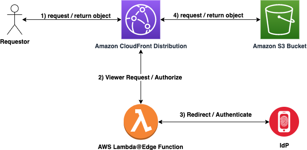

# @cxbuilder/google-authorizer

[](https://github.com/cxbuilder/cdk-google-authorizer/actions/workflows/ci-cd.yml)
[](https://www.npmjs.com/package/@cxbuilder/google-authorizer)
[](./LICENSE)

> Gate any CloudFront distribution behind Google OAuth with one Lambda@Edge function and zero servers.

Ship an internal dashboard, staging preview, or customer-specific content on S3 + CloudFront, and require Google Workspace sign-in at the CDN edge — the same way Cloudflare Access works, but on your own AWS account.



---

## Table of contents

- [Why](#why)
- [Install](#install)
- [Quick start](#quick-start)
  - [Pattern 1: Full static site in one construct](#pattern-1-full-static-site-in-one-construct)
  - [Pattern 2: Attach to a distribution you build yourself](#pattern-2-attach-to-a-distribution-you-build-yourself)
- [Example patterns](#example-patterns)
  - [Custom domain + ACM certificate](#custom-domain--acm-certificate)
  - [Protect only part of a site (mixed public + protected behaviors)](#protect-only-part-of-a-site-mixed-public--protected-behaviors)
  - [Protect a dynamic backend (ALB / API Gateway / ECS)](#protect-a-dynamic-backend-alb--api-gateway--ecs)
  - [Share one authorizer across multiple behaviors](#share-one-authorizer-across-multiple-behaviors)
  - [Post-auth email whitelist](#post-auth-email-whitelist)
  - [Store the client secret in AWS Secrets Manager](#store-the-client-secret-in-aws-secrets-manager)
  - [Stable signing keys across re-deploys](#stable-signing-keys-across-re-deploys)
  - [React / Vite / Next static export](#react--vite--next-static-export)
- [How it works](#how-it-works)
- [API reference](#api-reference)
- [Security notes](#security-notes)
- [Troubleshooting](#troubleshooting)
- [Limitations](#limitations)
- [Development](#development)
- [License](#license)

---

## Why

Static sites on S3 + CloudFront are dirt cheap and fast, but you can't just slap
a Google Workspace login in front of them without running a server somewhere.
This construct does it **at the CloudFront edge** — no ALB, no Cognito, no app
server, no auth proxy.

- ✅ Google Workspace sign-in (with `hd` hosted-domain enforcement)
- ✅ Signed, HttpOnly, Secure, SameSite=Lax session cookie
- ✅ Typed TypeScript source, modern `jose` crypto, single-file esbuild bundle (~470 KB)
- ✅ Works with custom domains or CloudFront's default `*.cloudfront.net`
- ✅ Drop-in `viewer-request` edge lambda — attach to any existing CloudFront behavior

## Install

This package is published to **GitHub Packages**, not npmjs.org. Tell npm to
use the GitHub registry for the `@cxbuilder` scope:

```bash
# One-time: add to your project's .npmrc (or ~/.npmrc)
echo "@cxbuilder:registry=https://npm.pkg.github.com" >> .npmrc

# Then install as usual
npm install @cxbuilder/google-authorizer
```

Installing from GitHub Packages requires authentication — even for public
packages. Create a [personal access token](https://github.com/settings/tokens)
with `read:packages` scope, then:

```bash
# Log in once; npm stores credentials in ~/.npmrc
npm login --scope=@cxbuilder --registry=https://npm.pkg.github.com
# Username: your GitHub username
# Password: <your PAT>
# Email: your-email@example.com
```

In CI, set `NODE_AUTH_TOKEN` to `${{ secrets.GITHUB_TOKEN }}` (no PAT needed
for the same-org case) and use `actions/setup-node` with
`registry-url: https://npm.pkg.github.com`.

Peer dependencies: `aws-cdk-lib ^2.233.0`, `constructs ^10.0.0`. Node 22+ required
at deploy time (so CDK can pick up the bundled Lambda asset).

Prerequisite: a **Google OAuth 2.0 Web Application** client. See
[docs/google-setup.md](docs/google-setup.md) for the 2-minute walkthrough.

---

## Quick start

### Pattern 1: Full static site in one construct

The `ProtectedStaticSite` construct spins up a private S3 bucket, a CloudFront
distribution, the authorizer, and a bucket deployment — the one-liner equivalent
of the legacy SAM template.

```typescript
import { App, Stack, SecretValue } from 'aws-cdk-lib';
import { Source } from 'aws-cdk-lib/aws-s3-deployment';
import { ProtectedStaticSite } from '@cxbuilder/google-authorizer';

const app = new App();
const stack = new Stack(app, 'MyStack', { env: { region: 'us-east-1' } });

new ProtectedStaticSite(stack, 'Site', {
  siteSource: Source.asset('./website'),
  clientId: 'xxx.apps.googleusercontent.com',
  clientSecret: SecretValue.secretsManager('google-oauth', { jsonField: 'clientSecret' }),
  hostedDomain: 'cxbuilder.ai',
});
```

`cdk deploy`, then add the `https://<cloudfront-domain>/_callback` URL to your
Google OAuth client's authorized redirect URIs. Done.

### Pattern 2: Attach to a distribution you build yourself

Use `GoogleAuthorizer` when you want full control over the CloudFront
configuration (multiple origins, custom cache policies, signed cookies for
parts of the site, etc.).

```typescript
import { App, Stack, SecretValue } from 'aws-cdk-lib';
import { Distribution, LambdaEdgeEventType } from 'aws-cdk-lib/aws-cloudfront';
import { S3BucketOrigin } from 'aws-cdk-lib/aws-cloudfront-origins';
import { Bucket } from 'aws-cdk-lib/aws-s3';
import { GoogleAuthorizer } from '@cxbuilder/google-authorizer';

const app = new App();
const stack = new Stack(app, 'MyStack', { env: { region: 'us-east-1' } });

const authorizer = new GoogleAuthorizer(stack, 'Authorizer', {
  clientId: 'xxx.apps.googleusercontent.com',
  clientSecret: SecretValue.secretsManager('google-oauth', { jsonField: 'clientSecret' }),
  hostedDomain: 'cxbuilder.ai',
});

const bucket = new Bucket(stack, 'Content');
const distribution = new Distribution(stack, 'Dist', {
  defaultBehavior: {
    origin: S3BucketOrigin.withOriginAccessControl(bucket),
    edgeLambdas: [authorizer.bindToBehavior()],
  },
});

// REQUIRED — creates the `cloudfront/{distributionId}` Secrets Manager secret
// that the Lambda reads at runtime.
authorizer.attachToDistribution(distribution);
```

> **Don't forget `attachToDistribution()`**. Without it the Lambda will run but
> log `ResourceNotFoundException` on every request — there's nothing to read
> from Secrets Manager.

---

## Example patterns

### Custom domain + ACM certificate

```typescript
import { Certificate } from 'aws-cdk-lib/aws-certificatemanager';

const cert = Certificate.fromCertificateArn(
  stack,
  'Cert',
  'arn:aws:acm:us-east-1:123456789012:certificate/…', // must be us-east-1
);

new ProtectedStaticSite(stack, 'Site', {
  siteSource: Source.asset('./website'),
  clientId,
  clientSecret,
  hostedDomain: 'cxbuilder.ai',
  domainNames: ['dashboard.cxbuilder.ai'],
  certificate: cert,
});
```

Register `https://dashboard.cxbuilder.ai/_callback` in your Google OAuth
client and you're done. The Lambda derives `redirect_uri` from the actual
`Host` header of the incoming request, so it works regardless of which alias
the user hit.

### Protect only part of a site (mixed public + protected behaviors)

Homepage is public, `/admin/*` requires Google sign-in:

```typescript
import { AllowedMethods, CachePolicy, Distribution } from 'aws-cdk-lib/aws-cloudfront';
import { S3BucketOrigin, HttpOrigin } from 'aws-cdk-lib/aws-cloudfront-origins';

const authorizer = new GoogleAuthorizer(stack, 'Authorizer', { /* … */ });

const publicBucket = new Bucket(stack, 'Public');
const adminBucket = new Bucket(stack, 'Admin');

const distribution = new Distribution(stack, 'Dist', {
  defaultBehavior: {
    origin: S3BucketOrigin.withOriginAccessControl(publicBucket),
    // No edgeLambdas — public
  },
  additionalBehaviors: {
    '/admin/*': {
      origin: S3BucketOrigin.withOriginAccessControl(adminBucket),
      edgeLambdas: [authorizer.bindToBehavior()],
      cachePolicy: CachePolicy.CACHING_DISABLED,
    },
    // The callback also needs the authorizer attached
    '/_callback': {
      origin: S3BucketOrigin.withOriginAccessControl(adminBucket),
      edgeLambdas: [authorizer.bindToBehavior()],
      cachePolicy: CachePolicy.CACHING_DISABLED,
    },
  },
});

authorizer.attachToDistribution(distribution);
```

> **Important:** the `callbackPath` (default `/_callback`) must route through
> the authorizer too, otherwise the OAuth callback never hits the Lambda.

### Protect a dynamic backend (ALB / API Gateway / ECS)

The authorizer is origin-agnostic — any CloudFront origin works. Point at an
ALB or API Gateway instead of S3:

```typescript
import { HttpOrigin } from 'aws-cdk-lib/aws-cloudfront-origins';

const authorizer = new GoogleAuthorizer(stack, 'Authorizer', { /* … */ });

const distribution = new Distribution(stack, 'Dist', {
  defaultBehavior: {
    origin: new HttpOrigin('my-service.internal.example.com'),
    edgeLambdas: [authorizer.bindToBehavior()],
    allowedMethods: AllowedMethods.ALLOW_ALL,
    cachePolicy: CachePolicy.CACHING_DISABLED,
    // Forward the TOKEN cookie so your backend can trust it
    originRequestPolicy: OriginRequestPolicy.ALL_VIEWER,
  },
});
authorizer.attachToDistribution(distribution);
```

Your backend can then read `req.headers.cookie` → `TOKEN` and verify it
(using the `publicKey` from the config secret) to get the authenticated email.

### Share one authorizer across multiple behaviors

On a single distribution, reuse the same `GoogleAuthorizer` instance:

```typescript
const authorizer = new GoogleAuthorizer(stack, 'Auth', { /* … */ });
const edge = authorizer.bindToBehavior();

new Distribution(stack, 'Dist', {
  defaultBehavior: {
    origin: appOrigin,
    edgeLambdas: [edge],   // same object, reused
  },
  additionalBehaviors: {
    '/api/*':     { origin: apiOrigin, edgeLambdas: [edge] },
    '/admin/*':   { origin: adminOrigin, edgeLambdas: [edge] },
    '/_callback': { origin: appOrigin, edgeLambdas: [edge] },
  },
});
authorizer.attachToDistribution(distribution);
```

For **multiple distributions**, create one authorizer per distribution — each
distribution has its own config secret named `cloudfront/{distributionId}`.

### Post-auth email whitelist

Combine `hostedDomain` with an explicit list for extra-tight access control:

```typescript
new GoogleAuthorizer(stack, 'Authorizer', {
  clientId,
  clientSecret,
  hostedDomain: 'cxbuilder.ai',
  allowedEmails: [
    'alice@cxbuilder.ai',
    'bob@cxbuilder.ai',
    'ops@cxbuilder.ai',   // distribution lists work too
  ],
});
```

`hostedDomain` is checked first (cheap, at the token-claim level);
`allowedEmails` is a post-auth filter that returns 401 for anyone not in the list.

### Store the client secret in AWS Secrets Manager

Don't commit client secrets to git. Put them in Secrets Manager (optionally as
JSON so you can store multiple values in one secret):

```bash
aws secretsmanager create-secret --name google-oauth \
  --secret-string '{"clientId":"xxx.apps.googleusercontent.com","clientSecret":"GOCSPX-…"}'
```

Then reference via CDK:

```typescript
new GoogleAuthorizer(stack, 'Authorizer', {
  clientId: 'xxx.apps.googleusercontent.com',
  clientSecret: SecretValue.secretsManager('google-oauth', { jsonField: 'clientSecret' }),
  hostedDomain: 'cxbuilder.ai',
});
```

CDK resolves the value at deploy time (inside CloudFormation, the plaintext
never touches your disk or the synthesized template). To rotate the secret,
update the Secrets Manager entry and run `cdk deploy` again.

### Stable signing keys across re-deploys

By default, `GoogleAuthorizer` generates a fresh RSA key pair on every `cdk synth`
— so every deploy invalidates existing sessions. For long-lived deployments,
generate a pair once and pass it in:

```bash
# One-time: generate key material and store in Secrets Manager
node -e "const{generateKeyPairSync}=require('crypto');const{privateKey,publicKey}=generateKeyPairSync('rsa',{modulusLength:2048,publicKeyEncoding:{type:'spki',format:'pem'},privateKeyEncoding:{type:'pkcs8',format:'pem'}});console.log(JSON.stringify({privateKey,publicKey}))" \
  | aws secretsmanager create-secret --name google-authorizer/signing-key --secret-string file:///dev/stdin
```

```typescript
const signingSecret = secretsmanager.Secret.fromSecretNameV2(
  stack, 'SigningSecret', 'google-authorizer/signing-key',
);

new GoogleAuthorizer(stack, 'Authorizer', {
  clientId,
  clientSecret,
  signingKeyPair: {
    privateKey: SecretValue.secretsManager('google-authorizer/signing-key', { jsonField: 'privateKey' }).unsafeUnwrap(),
    publicKey:  SecretValue.secretsManager('google-authorizer/signing-key', { jsonField: 'publicKey' }).unsafeUnwrap(),
  },
});
```

### React / Vite / Next static export

Build your SPA, then point `siteSource` at the output directory:

```typescript
new ProtectedStaticSite(stack, 'Dashboard', {
  siteSource: Source.asset('../frontend/dist'),   // Vite / Next static export
  clientId,
  clientSecret,
  hostedDomain: 'cxbuilder.ai',
  defaultRootObject: 'index.html',
});
```

SPAs with client-side routing: see
[CloudFront's "SPA with pretty URLs" pattern](https://docs.aws.amazon.com/AmazonCloudFront/latest/DeveloperGuide/GettingStarted.SimpleDistribution.html) — use a CloudFront Function or error-response rewrite to map 404 → `/index.html`.

---

## How it works

1. CloudFront invokes the Lambda@Edge function on every `viewer-request`.
2. The function reads its config from Secrets Manager at
   `cloudfront/{distributionId}` (Lambda@Edge forbids environment variables).
3. If the request carries a valid `TOKEN` cookie (RS256 JWT, verified against
   the config's `publicKey`, audience bound to the request Host), the request
   passes through to the origin unchanged.
4. Otherwise, the user is 302'd to `accounts.google.com/o/oauth2/v2/auth` with
   the standard authorization-code flow (plus `nonce`, `state`, optional `hd`).
5. On callback at `/_callback`, the Lambda:
   - Exchanges the `code` at `oauth2.googleapis.com/token`
   - Verifies the ID token signature against Google's JWKS (`jose` caches internally)
   - Checks `iss`, `aud`, `exp`, `hd` (if configured), `allowedEmails` (if configured), and the nonce
   - Issues its own RS256-signed session JWT as a `TOKEN` cookie
   - 302's back to the originally-requested URL (from a sanitized `state`)

Cold-start footprint: the esbuild bundle is ~470 KB (limit 1 MB). Typical cold
start is 200-400 ms; warm invocations are single-digit milliseconds.

---

## API reference

### `GoogleAuthorizer`

| Prop | Type | Default | Description |
|---|---|---|---|
| `clientId` | `string` | — | Google OAuth 2.0 client ID |
| `clientSecret` | `SecretValue` | — | Client secret. Prefer `SecretValue.secretsManager(…)` |
| `hostedDomain` | `string` | — | Google Workspace domain to restrict to (sent as `hd`, validated on ID-token claim) |
| `allowedEmails` | `string[]` | — | Post-auth email allow-list (checked after `hostedDomain`) |
| `sessionDuration` | `Duration` | `1h` | Session cookie lifetime |
| `callbackPath` | `string` | `/_callback` | OAuth callback URL path |
| `signingKeyPair` | `{privateKey,publicKey}` | _generated_ | RS256 PEM key pair for session JWTs |

| Member | Type | Purpose |
|---|---|---|
| `edgeFunction` | `cloudfront.experimental.EdgeFunction` | The Lambda@Edge function |
| `bindToBehavior()` | `() => cloudfront.EdgeLambda` | Returns the association to drop into any behavior's `edgeLambdas` |
| `attachToDistribution(dist)` | `(IDistribution) => secretsmanager.Secret` | Creates the runtime config secret; call once per distribution |
| `configSecretString` | `string` | The raw JSON config. Advanced use only |

### `ProtectedStaticSite`

All `GoogleAuthorizer` props, plus:

| Prop | Type | Default | Description |
|---|---|---|---|
| `siteSource` | `ISource \| ISource[]` | — | Static-content asset(s) for S3 deployment |
| `domainNames` | `string[]` | — | Custom domain(s); requires `certificate` |
| `certificate` | `acm.ICertificate` | — | ACM cert in **us-east-1** |
| `defaultRootObject` | `string` | `'index.html'` | |
| `priceClass` | `cloudfront.PriceClass` | `PRICE_CLASS_100` | |
| `removalPolicy` | `RemovalPolicy` | `RETAIN` | `DESTROY` also enables `autoDeleteObjects` on the buckets |

| Member | Type | Purpose |
|---|---|---|
| `bucket` | `s3.Bucket` | Content bucket |
| `logBucket` | `s3.Bucket` | Access-log bucket |
| `distribution` | `cloudfront.Distribution` | The CloudFront distribution |
| `authorizer` | `GoogleAuthorizer` | The underlying authorizer, for wiring additional behaviors |

---

## Security notes

- **Session cookie** is `HttpOnly`, `Secure`, `SameSite=Lax`, RS256-signed with
  a 2048-bit RSA key, audience-bound to the request `Host` header.
- **`state` parameter** is sanitized on both the outbound and callback legs —
  protocol-relative (`//evil.com/path`) and backslash-prefixed variants are
  rewritten to `/` to prevent open redirects from being used as phishing
  springboards. See [test/lambda/handler.test.ts](test/lambda/handler.test.ts).
- **Nonce** is generated per-flow and HMAC-bound to an `HttpOnly`+`Secure`
  cookie; the cookie and the ID-token nonce claim must match or the callback
  returns 401.
- **`hd` claim** is enforced server-side (in the Lambda) — not just passed to
  Google as a UI hint — so a user can't bypass by tampering with the URL.
- **Client secret** never appears in the synthesized CloudFormation template
  when supplied via `SecretValue.secretsManager(…)`; CFN resolves it at deploy
  time inside AWS's own infrastructure.
- **Secrets Manager lookup** at runtime is scoped to the specific distribution
  ID via `cloudfront/{distributionId}` — even if the Lambda's IAM role grants
  read on any `cloudfront/*` secret, only the one belonging to the invoking
  distribution is ever fetched.

Threat model **not** covered: a compromised origin (if someone can publish
arbitrary content to the S3 bucket, they can trivially steal the `TOKEN`
cookie via JS, _unless_ you add a CSP that forbids it — see below).
Mitigation: lock down origin write access; consider adding a CSP via
CloudFront response headers policy.

## Troubleshooting

**"redirect_uri_mismatch" from Google**
: The CloudFront URL `https://<host>/_callback` must be registered exactly
  (scheme, host, port, path) in the Google OAuth client's Authorized redirect
  URIs. After the first deploy, copy the URL from the `CallbackUrl` stack
  output and add it in the Google Cloud Console.

**Lambda logs `ResourceNotFoundException: Secrets Manager can't find the specified secret`**
: You forgot `authorizer.attachToDistribution(distribution)`, or the Distribution
  hasn't finished creating yet. Check `cloudfront/{distributionId}` exists in
  Secrets Manager in **us-east-1**.

**"CloudFront isn't associating my edge lambda"**
: Lambda@Edge requires the function to be in `us-east-1`. The construct uses
  CDK's `experimental.EdgeFunction` which handles this automatically if your
  parent stack is in another region (it creates a support stack).

**"I get 401 Unauthorized every time, even though I signed in"**
: Most common: the browser is blocking `SameSite=Lax` cookies on the callback
  redirect. Make sure you hit the CloudFront URL over HTTPS (the `Secure` flag
  requires it). Also check the Google account's email matches `hostedDomain`
  and `allowedEmails` if either is set.

**"Stack destroy leaves a Lambda@Edge replica behind for 30 minutes"**
: This is an AWS limitation, not the construct. CloudFormation deletes the
  function version immediately, but AWS asynchronously removes edge replicas
  over the following 15-30 minutes. Plan deletion timing accordingly.

**Cold starts are slow**
: The bundle is already minimized (~470 KB). Most of the latency is Node 22
  cold-start + JIT. Warm invocations are sub-10 ms. If latency is critical,
  consider a CloudFront cache policy that caches successful-auth responses
  briefly (but never the callback).

## Limitations

- **Region**: edge function is always in `us-east-1` (AWS requirement).
- **No environment variables** on Lambda@Edge — all runtime config comes from
  Secrets Manager.
- **No PKCE** — this is a server-side (Lambda@Edge) flow, the client secret
  is available. PKCE is for public clients (SPAs, native apps) that can't
  keep a secret.
- **Single distribution per authorizer secret** — each distribution gets its
  own `cloudfront/{distributionId}` secret. Sharing a single secret across
  distributions is not supported because the Lambda uses the distribution ID
  in the event as its lookup key.
- **Session cookie is not refreshed**: when it expires, the user is bounced
  through Google again. Adjust `sessionDuration` to taste (`Duration.hours(8)`
  for a workday, etc.). Tokens don't carry Google's refresh token — this
  construct re-authenticates rather than refreshing.

---

## Development

```bash
npm ci
npm run build       # esbuild bundle + tsc
npm test            # jest (28 tests, includes CDK template assertions)
```

Manual integration test against a real AWS account: see
[integ/README.md](integ/README.md).

Contributions welcome — see [CONTRIBUTING.md](CONTRIBUTING.md). The package
uses plain TypeScript (no JSII) and publishes to npmjs.org via GitHub Actions;
pushing a version bump to `main` publishes automatically.

## License

MIT-0. Originally forked from
[aws-samples/lambdaedge-openidconnect-samples](https://github.com/aws-samples/lambdaedge-openidconnect-samples)
and rewritten from scratch as a CDK construct.
